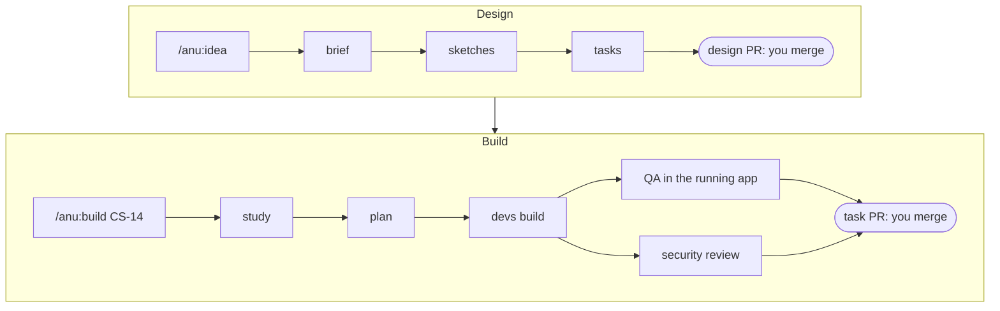

# anu documentation

anu is a Claude Code plugin that takes an idea to merged code in any app. It holds the
process only: how an idea becomes a brief, sketches and tasks, and how a task becomes a reviewed
pull request. Each app keeps its own facts (stack, checks, ports, dev sign-in, screen sizes,
styles) in a `## anu` section of its CLAUDE.md.

## Read in this order

| Page | What it covers |
|---|---|
| [Getting started](getting-started.md) | Install anu, set up an app, design a first feature, build a first task |
| [How it works](how-it-works.md) | The flow, where it stops, stages, branches and worktrees, task IDs, the files it writes |
| [Commands](commands.md) | All 13 commands: input, steps, stops, files written, what comes next |
| [The build team](team.md) | The four agents, how a build runs, what "verified" means, the read-only reviewers |
| [Configuration](configuration.md) | The `## anu` section key by key, settings, the dev sign-in route |
| [Troubleshooting](troubleshooting.md) | Every message anu stops with, why, and what to do |
| [Changing anu](contributing.md) | Repo layout, rules for skills and agents, testing, releasing, the logo |

## In one picture

You approve the design (approach, brief, each sketch, task list) and you merge the PRs. Between
those, anu decides and writes down every call it made under "Decisions taken".
