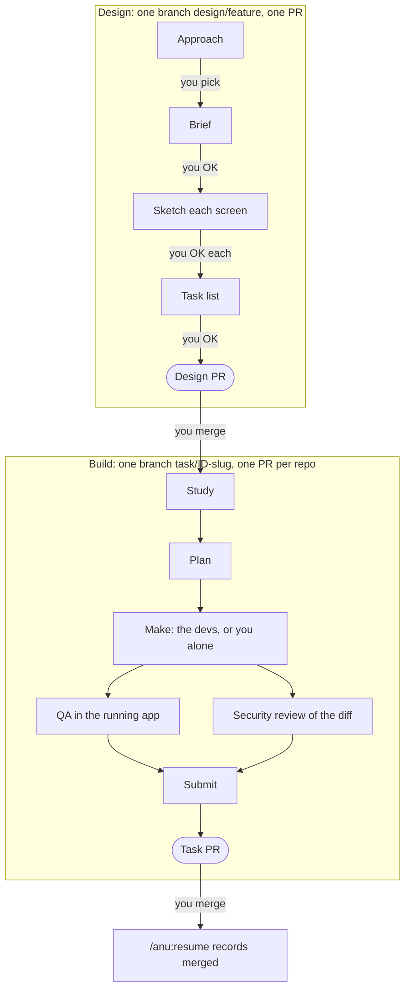

# How it works

## Process in the plugin, facts in the app

anu ships no app facts. Ports, check commands, the dev sign-in URL, screen sizes, the styles
file, the task prefix — all of it lives in the `## anu` section of each app's CLAUDE.md, written
once by `/anu:setup`. Every command reads that section first. If it is missing, the command stops
with "Run /anu:setup first."

So one install of anu serves every app, and changing an app's facts is a one-line PR in that app.

## The flow



## Where it stops

anu stops for you in two places only:

| Where | Stops |
|---|---|
| **Design** (`/anu:idea`) | the approach, the brief, each sketch, the task list |
| **Merge** | every PR. anu never merges and never turns on auto-merge |

From `/anu:build` (or `/anu:study`) to the PR there is no stop. A gap the plan does not cover is
decided — the brief's default, else the smallest choice that exposes no more data than the brief
allows — and written under `## Decisions taken` in `plan.md`. The PR lists every one, so you
review the calls together with the code.

Some things are not decisions but problems, and they still stop:

| Problem | Why it stops |
|---|---|
| A task in `Blocked by` has no merged PR | building on unmerged work builds on something that may change |
| The task's design PR is not merged | the brief, sketches or task may still change |
| A screen has no sketch file under `docs/sketches/` | a screen is never designed from prose alone |
| The branch differs from `state.json` | anu may be about to work in the wrong place |
| No browser tool, or no dev sign-in route | QA could not see the app or get past the login; asked once, at the start |
| A rebase conflict whose intent is unclear | only you know which side is right |
| `git config user.name` is empty | commits must carry your identity; anu asks for it once |
| Anything destructive or outside the local stack | a deploy, a real third-party service, production data, billing |

The last question anu asks is after the PR is open: was anything about anu friction, confusing,
or worth changing. Your answer goes into the PR under `## anu feedback`. If it asks for a change
to anu, anu says where to open an issue; it never files one itself, because your words may
carry details of your app.

## Stages and `state.json`

Every task keeps its notes in `docs/work-notes/<ID>/` on its own branch. `state.json` records the
**last finished** stage:

```json
{
  "task": "CS-14",
  "file": "docs/tasks/CS-14-invite-member.md",
  "stage": "planned",
  "branch": "task/CS-14-invite-member",
  "pr": [],
  "updated": "2026-11-16"
}
```

No path is stored. The worktree is found by its branch (`git worktree list`), so the notes work
on any machine and for any teammate.

| `stage` | Means | Next |
|---|---|---|
| `null` | worktree made, nothing finished | study |
| `studied` | `study.md` written | plan |
| `planned` | `plan.md` written | make (alone) or build (team) |
| `made` | code written, checks green, screens looked at | submit |
| `submitted` | PR open | review fixes, then you merge |
| `merged` | every PR merged | done; remove the worktree |

Any step started too early runs the step before it first, instead of sending you back.
`/anu:resume <ID>` reads the stage and runs the next step. `/anu:resume <feature>` does the same
for a design branch: it carries on from the first missing step, or answers the PR's review.

## Branches and worktrees

All work happens in a git worktree on a branch off the app's **base branch**: the `Base branch`
key in `## anu`, or `main` when the key is absent. This page writes it `origin/<base>`. anu
never commits to the base branch, never switches the main checkout's branch, and never uses `git stash` (one stash is shared by
every worktree of a repo, so a stash in one session can be popped in another).

| Work | Branch | Worktree |
|---|---|---|
| Setup | `anu/setup` | `.claude/worktrees/anu-setup` |
| A feature's design | `design/<feature>` | `.claude/worktrees/design-<feature>` |
| A task | `task/<ID>-<slug>` | `.claude/worktrees/<ID>` |
| Lessons | `lessons/<topic>` | `.claude/worktrees/lessons-<topic>` |

If the session already runs in a fresh worktree, anu reuses it instead of making another. It
checks three things first:

1. it is a **linked worktree**: `.git` at its root is a file, not a folder
   (`test -f "$(git rev-parse --show-toplevel)/.git"`). In the main checkout `.git` is a folder,
   so the main checkout's branch is never renamed;
2. it has no commits beyond `origin/<base>`;
3. it has nothing uncommitted.

Then it renames the branch with `git branch -m`. Otherwise it runs `git worktree add`.

This is what lets you run two or three sessions on one repo at once: each works in its own
folder on its own branch.

A task that changes one of `Other repos` gets a worktree in that repo too, on the same branch
name and off that repo's own base branch. `/anu:plan` makes it, once the plan shows the repo is
touched.

## Task IDs

IDs come from one place: the `Next:` line at the top of `docs/todo.md`.

```markdown
# To do

Next: CS-17

## Coming
- CS-14 Invite a member — docs/tasks/CS-14-invite-member.md
```

- `/anu:tasks` rebases onto `origin/<base>`, reads `Next:`, takes the IDs from there, moves the
  line on, and commits that change on its own before writing any task file. It never takes an ID
  from file names.
- If the rebase before the PR conflicts on the `Next:` line, someone else took those IDs first.
  anu keeps their line, renumbers its own tasks from their `Next:` value (file names, IDs inside
  the files, every `Blocked by`, the `## Coming` lines, the brief's links) and carries on. If the clash shows only after the PR
  is open, `/anu:resume <feature>` does the same and pushes with `--force-with-lease`.
- IDs always match exactly. `CS-4` finds `CS-4-invite.md` and `task/CS-4-…`, never `CS-41-…`.
- Notes are found by the ID folder `docs/work-notes/<ID>/`, never by date.

## Blockers

A task's `Blocked by` line lists task IDs. Before building, anu searches each repo for PRs whose
title starts with `<ID>:` and checks every one is `MERGED`. Open, closed or no PR at all counts
as not done: anu names the blocker and its state, and goes on only if you say so.

## Tasks are vertical slices

Each task is one behaviour a user can test in the running app — its data, its server code and
its screen — sized at 1–3 days. There is never a backend-only, frontend-only or data-only task.
A task too big is cut by behaviour ("invite by email", "resend an invite"), still top to bottom.

## What anu writes in an app repo

```
CLAUDE.md                                 the ## anu section (setup)
.claude/settings.json                     turns anu on for the repo (setup)
docs/todo.md                              Next: line, Coming, Follow-ups
docs/briefs/YYYY-MM-DD-<feature>.md       one per feature
docs/sketches/YYYY-MM-DD-<feature>/       screens.md, screen-NN-<name>.html, -narrow.html, tokens.css
docs/tasks/<ID>-<slug>.md                 the ID always in the name, no date
docs/work-notes/<ID>/                     state.json, study.md, plan.md, shots/*.png
LESSONS.md                                what broke before and must not break again
```

## Commits and pull requests

- Commits carry the developer's own git identity only. No AI co-author trailer, no "generated
  with" line.
- Files are added by name, never `git add -A`.
- Before every push: `git fetch origin` and `git rebase origin/<base>`; checks run again if the
  rebase brought new commits.
- PR bodies are written to a temp file and passed with `--body-file`, so backticks survive.
- A task that changes more than one repo gets one PR per repo, each linking the others under
  `## Related PRs`.
- anu never merges and never turns on auto-merge.
- anu never writes into its own plugin folder. Feedback about anu goes into the PR body.
