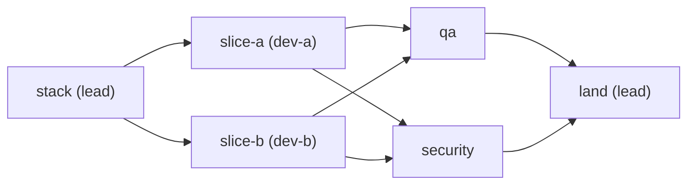

# The build team

`/anu:build` runs a task with four kinds of agent, working as a Claude Code agent team: they
share a task list and message each other, instead of each reporting only to the session that
started it.

## Who is on it

| Agent | Name in the team | Model | Can edit files | Does |
|---|---|---|---|---|
| `anu:tech-lead` | (your session) | fable | yes | studies, plans, splits the work, starts the local stack, gates each slice, lands the PR |
| `anu:senior-dev` | `dev-a`, `dev-b` | opus | only the files it owns | builds one slice, tests it, looks at it running; one dev per slice |
| `anu:qa-engineer` | `qa` | sonnet | no | checks the task in the running app against its acceptance lines and sketches |
| `anu:security-engineer` | `security` | opus | no | reviews the diff and the code it calls into |

Each agent definition pins its own model, so the tech lead spawns by agent type and never names
a model.

QA and security are read-only in two ways. `Edit`, `Write` and `NotebookEdit` are turned off in
their definitions. And a hook that ships with anu (`hooks/read_only.py`) refuses their shell
commands that write a file (`>`, `sed -i`, `rm`, `mv`, `cp`) or change git state (`commit`,
`push`, `checkout`, `stash`). The hook matches patterns; it is not a sandbox, so a write hidden
inside `python -c` or `bash -c` still passes, and their instructions forbid that too.

## Turning it on

Agent teams are an experimental Claude Code feature. In `~/.claude/settings.json`:

```json
{ "env": { "CLAUDE_CODE_EXPERIMENTAL_AGENT_TEAMS": "1" } }
```

Restart Claude Code, then start the session as the tech lead:

```bash
claude --agent anu:tech-lead
```

`/anu:build` checks both and stops with the fix if either is missing. It also checks QA can
work — a browser tool, and a dev sign-in route in `## anu` — before anyone is spawned.

## How a build runs



1. **Study and plan.** The lead does both before anyone is spawned. The plan splits the task into
   two slices with no file in common — usually the screen (`dev-a`) and the server and data
   (`dev-b`). A shared file such as a router or `package.json` belongs to one dev; the other asks
   its owner for the change. The shared interfaces (endpoint or function names, inputs, outputs,
   errors, data fields) are written down first. A task too small to split is one slice: the lead
   spawns `dev-a` only, and QA and security wait on that one slice.
2. **Local stack.** The lead starts the one local stack from `## anu` in the task's worktree,
   seeds it if the app has a seed step, and tells the team it is up. It never starts a second
   copy and never stops one another session started (it checks with `lsof -a -p <pid> -d cwd`).
3. **Spawn.** Teammates do not see the lead's conversation, so every spawn prompt carries the
   full brief: the task ID, the worktree path, the paths of the task file, `study.md` and
   `plan.md`, the teammate's slice and exact files, the shared interfaces word for word, the
   `## anu` facts it needs, what is out of the task, and who it reports to.
4. **Build and gate.** A slice is done only when all three hold:
   - its dev reports every check green;
   - `qa` has verified it in the running app;
   - `security` has cleared its diff.

   Defects and findings go to the owning dev by name, with a copy to the lead. The lead does not
   fix them itself, and asks QA or security to re-check after the fix.
5. **Land.** The lead runs `/anu:submit`, which uses the QA and security reports for the PR's
   `## Acceptance` and `## Security` sections, and adds `## Slices` (who built what).
6. **Close.** The lead asks each teammate to shut down, stops the local stack if it started it,
   and reports the PR links, what QA verified, security findings, decisions taken and what was
   left out.

Teammate permission prompts land in the lead's session and the lead answers them. A teammate
silent for 10 minutes gets a ping; if it still does not answer, the lead does its remaining
check itself and says so in the PR.

## What the senior devs follow

- Source of truth, in order: the shared interfaces, then `plan.md`, the task file, `study.md`
  and the brief, then the sketches and their screenshots.
- Read the `LESSONS.md` entries for every file before touching it.
- Follow the patterns `study.md` names. No option, wrapper or abstraction the task does not need.
- Every new piece of logic leaves a test; no existing test is deleted.
- Edit only their own files. A change in a file another teammate owns is sent to that owner.
- No commits, pushes, rebases or PRs (the lead lands the task), no branch switches, no stash,
  never start or stop the local stack, never deploy, never call a real third-party service.
- A gap that changes what a user sees or what data is exposed goes to the lead; a gap inside
  their own files (a helper name) they decide and list.

## What "verified" means to QA

1. **Acceptance.** Every acceptance line works in the running app, including its error, empty
   and permission cases. Nothing the task leaves out is live.
2. **Matches the sketch.** Layout, copy, icons and states, except where `plan.md` "Decisions
   taken" changed them.
3. **Every size, both themes.** Every screen size in `## anu`, light and dark: no overflow,
   clipping or unreadable contrast.
4. **Easy and safe to use.** Loading, empty and error states; Esc closes dialogs and returns
   focus; changes are announced; frequent tasks work from the keyboard; a role sees only its
   controls.
5. **The checks pass.**

QA signs in with the dev sign-in URL, drives the page with a browser tool, and saves screenshots
as `docs/work-notes/<ID>/shots/qa-<screen>-<size>-<theme>.png`. It never marks a visual check
passed without seeing the page. Defects are rated blocker, should fix or cosmetic.

## What security checks

On every task, in the diff and the code it calls into:

- **Access** — every server entry point checks the caller on the server, against the data itself,
  never trusting an id, role or flag from the client.
- **Isolation** — no one reaches another user's or tenant's data by changing an id or a filter.
- **Data exposure** — responses, logs, errors and URLs carry only what the caller needs.
- **Input and output** — validated at the edge; no queries, shell commands or paths built from raw
  input; stored data escaped when rendered; redirect targets checked.
- **Codes and tokens** — random, hashed, compared in constant time, rate-limited, expiring,
  single-use.
- **Dev-only paths** — dev sign-in, fake mail, seeds and debug endpoints open only outside
  production, checked in the code, with no flag that can open them on a deployed host.
- **Secrets** — none in client code, commits, fixtures or logs.
- **Scope** — nothing out of scope wired up.
- **Dependencies** — why each new package is needed, its licence, where it runs.

Findings are rated **blocker** (fix before landing), **should fix** (land with a follow-up) or
**note**, each with file:line and the smallest fix. A clean review says "No findings" and what
was checked.

## The reviewers on the solo path

When you build alone (`/anu:make`), `/anu:submit` runs `anu:qa-engineer` and
`anu:security-engineer` as plain read-only subagents, at the same time. They get the same brief a
teammate would and put everything in their final report instead of messaging a dev. Fails and
blockers are fixed and sent back to the same agent for a re-check before the PR opens.

## The rules the lead keeps

- Build only what the task and its brief allow; what they leave out is not built, even if a
  sketch draws it.
- No stop until the PR: decide, and list each call under "Decisions taken".
- Stop only for something destructive or outside the local stack: a real third-party service, a
  deploy, production data, billing.
- Never deploy, never commit to the base branch, never merge. Commits and PRs carry your identity only.
- One short status line to you each time a shared task changes state.
